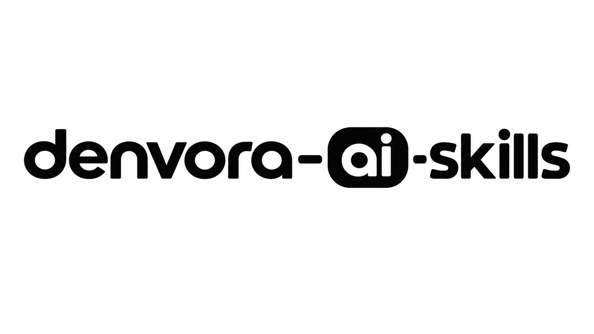

<p align="center">
  
</p>

<p align="center">
  <strong>Make your AI coding assistant careful, honest, and beginner-friendly.</strong><br>
  An open-source Agent Skill that stops AI from inventing code, skipping checks, and saying "done" when it isn't.
</p>

<p align="center">
  <a href="LICENSE"></a>
  <a href="https://github.com/ardenpratamamaskuri404/denvora-ai-skills/actions/workflows/validate.yml"></a>
  
  
</p>

<p align="center">
  <a href="#quick-start">Quick start</a> ·
  <a href="#what-it-changes">What it changes</a> ·
  <a href="docs/installation.md">Install guide</a> ·
  <a href="docs/prompt-templates.md">Prompt templates</a> ·
  <a href="#bahasa-indonesia">Bahasa Indonesia</a>
</p>

---

## Why

If you are vibe coding, you probably can't review every line the AI writes. That's fine, but it means you depend on the AI telling the truth. Common problems:

- It **invents** functions, libraries, CLI flags, or versions that don't exist.
- It **edits code without reading** your project first.
- It **dumps hundreds of lines** of untested code at once.
- It says **"done, it works!"** without running anything.
- When there's an error, it **keeps guessing** instead of finding the cause.

**denvora-ai-skills** is a set of working rules your AI reads automatically. It doesn't write code for you. It changes *how* your AI works, so the code you get is more likely to actually run, and you always know what was checked and what wasn't.

## Quick start

You need [Node.js](https://nodejs.org/) 18+ for `npx`.

```bash
# Google Antigravity, this project only
npx skills add ardenpratamamaskuri404/denvora-ai-skills -a antigravity

# Google Antigravity, all projects
npx skills add ardenpratamamaskuri404/denvora-ai-skills -a antigravity -g
```

Then **start a new agent session** and ask for something normal, like *"build me a todo app"* or *"fix this error"*. The skill triggers on its own.

Using Claude, Cursor, Windsurf, Codex, or another tool? Or a chat AI without skill support? See the **[installation guide](docs/installation.md)** for every option, including manual copy and the `.skill` upload.

## What it changes

| Without the skill | With denvora-ai-skills |
|---|---|
| Uses a function it "remembers" from an old version | Checks your installed version, or says **[Unsure]** |
| Rewrites a file it never opened | Reads the file and your project structure first |
| Writes the whole app in one reply | Builds in small slices and checks each one |
| "This should work!" | "Ran `npm run build`: 0 errors. Not tested: mobile layout." |
| Tries random fixes for an error | Reads the error, tests one hypothesis at a time, stops after 3 misses |
| Wall of jargon | Your language, plain words, and the exact command to run |

*The table describes the behavior the skill asks for. Measured results will be published in [`tests/results/`](tests/results/) as test rounds are completed; we don't publish numbers we haven't measured.*

### Example report

At the end of a task, the AI gives you a short, honest summary:

```
What I did:    Added a "Loading..." state to the profile page
Verified:      [Certain] npm run build - 0 errors
Not verified:  Mobile layout. Check with: npm run dev, then open on your phone
Assumptions:   Kept your existing Tailwind styles
Next step:     Add an error message if the profile fails to load
```

## How it works

```
skills/denvora-ai-skills/
├── SKILL.md                         # Core rules (short, loaded when the skill triggers)
└── references/                      # Detailed guides, read only when needed
    ├── workflow.md                  # Understand → inspect → plan → build → verify → report
    ├── verification-checklist.md    # What counts as "verified"
    ├── debugging-protocol.md        # Evidence-based debugging, one change at a time
    ├── beginner-communication.md    # Plain language, ID/EN examples
    └── security-checklist.md        # Check before going online
```

The core rules:

1. **Never invent.** If it's not verified, it gets checked or labeled.
2. **Read before you write.** Follow the project's existing patterns.
3. **Ask only blocking questions.** State other assumptions and keep going.
4. **Build in small slices.** Each one runs before the next starts.
5. **Verify, then claim.** No "done" without evidence.
6. **Debug with evidence.** Root cause first, one change at a time.
7. **Be honest about uncertainty** with **[Certain] / [Likely] / [Unsure]** labels.
8. **Protect your work.** Ask before deleting, resetting, or overwriting anything.

It also scales down: a one-line rename gets a one-line answer, not a ten-step plan.

The skill is **plain Markdown**. No scripts, no network calls, no tracking. Read every file before you install; see [SECURITY.md](SECURITY.md).

## Supported agents

Works with any tool that supports Agent Skills, including Google Antigravity, Claude, Claude Code, Cursor, Windsurf, Codex, Gemini CLI, and GitHub Copilot. For tools without skill support, tell the AI to read `SKILL.md` or paste it in.

We keep "install path verified" and "behavior tested" separate. See the current status in **[docs/supported-agents.md](docs/supported-agents.md)**.

## Testing

The skill is only useful if it measurably changes AI behavior. The [test suite](tests/README.md) has 15 realistic prompts (build, fix, edit, unfamiliar library, vague request, tiny task, safety) with expected behaviors and a scoring rubric. Each prompt is run **with and without** the skill, and every failure becomes a new rule or example.

Want to help? Run a few cases on your agent and share the results.

## Roadmap

| Version | Scope |
|---|---|
| **v0.1** (now) | Core skill, references, test suite, docs, install via Skills CLI |
| v0.5 | First recorded test round on Antigravity; rules tuned from real failures |
| v1.0 | Public launch: before/after demo, examples, first tagged release |
| v1.x | Stack references (Next.js/React, Python/FastAPI, Flutter, Laravel), more languages |
| v2.0 | Optional `npx denvora-ai-skills` CLI, community gallery, beginner starter flows |

See [CHANGELOG.md](CHANGELOG.md) for what's changed.

## Contributing

The best contribution is a **real case**: a time an AI still guessed, over-claimed, or confused you. [Report it here](https://github.com/ardenpratamamaskuri404/denvora-ai-skills/issues/new?template=hallucination-report.yml) (English or Indonesian). Each one can become a rule that helps everyone.

Code and docs contributions are welcome too. Read [CONTRIBUTING.md](CONTRIBUTING.md) and look for **good first issue** labels.

## Bahasa Indonesia

**denvora-ai-skills** adalah skill open-source yang bikin AI coding assistant kamu lebih hati-hati dan jujur: tidak mengarang fungsi atau library, membaca kode dulu sebelum mengubah, membangun sedikit demi sedikit, dan tidak bilang "sudah jalan" kalau belum dicek. Cocok untuk vibe coder dan pemula.

**Cara pasang (Antigravity):**

```bash
npx skills add ardenpratamamaskuri404/denvora-ai-skills -a antigravity
```

Lalu buka **sesi agent baru** dan minta seperti biasa, misalnya *"bikinin aplikasi todo"* atau *"tolong perbaiki error ini"*. AI akan membalas dalam Bahasa Indonesia dan memberi label **[Pasti] / [Kemungkinan] / [Belum yakin]** pada klaim penting.

**Pakai AI lain yang belum mendukung skill?** Cukup suruh AI-nya membaca file ini:

```
Baca skills/denvora-ai-skills/SKILL.md dan ikuti aturannya selama percakapan ini.
```

Panduan lengkap: [instalasi](docs/installation.md) · [template prompt (ID/EN)](docs/prompt-templates.md) · [lapor kasus "AI masih ngawang"](https://github.com/ardenpratamamaskuri404/denvora-ai-skills/issues/new?template=hallucination-report.yml)

## License

[MIT](LICENSE) © 2026 Arden Pratama Maskuri
